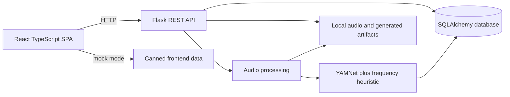

# Western Ghats Sound Identifier

An audio analysis web application for exploring candidate bird and frog call detections in recordings from India's Western Ghats. Upload audio, review timestamped results and an annotated spectrogram, and download biodiversity reports.

> **Model limitation:** YAMNet identifies broad sound classes. The current species names are assigned using a dominant-frequency heuristic and a regional reference table. They are candidate suggestions, not verified species identifications.

## Table of Contents
- [Problem Statement](#problem-statement)
- [Project Objectives](#project-objectives)
- [Key Features](#key-features)
- [System Architecture](#system-architecture)
- [Technology Stack](#technology-stack)
- [Project Directory Structure](#project-directory-structure)
- [Application Workflow](#application-workflow)
- [Installation and Setup](#installation-and-setup)
- [Environment Variables Configuration](#environment-variables-configuration)
- [Running the Application](#running-the-application)
- [API Documentation](#api-documentation)
- [AI/ML Model Details](#aiml-model-details)
- [Screenshots](#screenshots)
- [Future Enhancements](#future-enhancements)
- [Team / Contributors](#team--contributors)
- [License](#license)

## Problem Statement
Reviewing wildlife field recordings manually is time-consuming. This project provides a browser workflow to submit recordings and surface possible bird/frog call events with timestamps and summaries. It is a prototype and does not scientifically establish species identity.

## Project Objectives
- Provide a web interface for audio submission and analysis.
- Normalize audio and identify broad bird/frog-related sound events.
- Present candidate species, event timing, confidence, and summary statistics.
- Store recording history and generate spectrogram/report artifacts.
- Support optional accounts, sharing, analytics, and a public community feed.

## Key Features
- WAV, MP3, and M4A uploads (500 MB default maximum), optional location and coordinates.
- Background-thread analysis with pollable job status.
- Timestamped detections, confidence, per-species summaries, and Shannon diversity.
- Annotated Mel-spectrogram PNG, PDF report, and CSV export.
- History, analytics, species reference, public recordings, and contributor leaderboard.
- Username/password accounts and bearer tokens; uploads and analytics also support anonymous requests.
- Optional frontend mock mode with canned sample data.

## System Architecture


The API creates database tables at startup. Run backend/seed_data.py to populate/update species reference rows. Analysis runs in an in-process daemon thread.

## Technology Stack
| Area | Implemented technologies |
|---|---|
| Frontend | React 18, TypeScript, Vite, React Router, TanStack Query, Axios, Tailwind CSS, Recharts, Leaflet |
| Backend | Python, Flask, Flask-CORS, Flask-SQLAlchemy, SQLAlchemy, Waitress |
| Audio/ML | TensorFlow, TensorFlow Hub, YAMNet, librosa, SoundFile, NumPy, SciPy |
| Database | SQLite by default; PostgreSQL URI support |
| Reports/visualization | pandas, ReportLab, Matplotlib, Pillow |
| Test tooling present | pytest, Vitest, Testing Library |

## Project Directory Structure
```text
.
├── README.md
├── backend/
│   ├── app.py
│   ├── auth.py
│   ├── audio_processor.py
│   ├── config.py
│   ├── ml_inference.py
│   ├── models.py
│   ├── report_generator.py
│   ├── seed_data.py
│   ├── species_reference.py
│   ├── requirements.txt
│   ├── data/yamnet_class_map.csv
│   ├── scripts/smoke_test.py
│   └── tests/
└── frontend/
    ├── package.json
    ├── package-lock.json
    ├── vite.config.ts
    └── src/
        ├── components/
        ├── hooks/
        ├── pages/
        ├── services/
        ├── test/
        ├── App.tsx
        └── types.ts
```

## Application Workflow
1. The user uploads a WAV/MP3/M4A file with optional location information to POST /api/audio/upload.
2. The UI starts POST /api/process/{file_id}; the backend creates a job and processes it in a daemon thread.
3. Audio is decoded to mono, peak-normalized 16 kHz float audio, quality-assessed, and passed to YAMNet. The UI polls job status.
4. Bird/frog class scores are thresholded and adjacent frames merged. An FFT dominant-frequency estimate maps events to candidate regional species.
5. Results and quality summary are stored; a Mel spectrogram with event overlays is generated. UI offers result charts and PDF/CSV downloads.
6. History and analytics read stored records. Users can mark recordings public for the Community feed.

**Browser recording note:** the UI has a MediaRecorder hook that emits WebM, but the backend only accepts WAV, MP3, and M4A. Browser-captured audio is not currently a compatible end-to-end upload path.

## Installation and Setup
Requirements: Node.js/npm and Python 3.10–3.11 (backend-recommended). M4A decoding may need ffmpeg. First real inference can download YAMNet from TensorFlow Hub; cache defaults to backend/data/models/tfhub/.

### Backend
From the repository root, in PowerShell:
```powershell
cd backend
python -m venv venv
venv\Scripts\Activate.ps1
python -m pip install -r requirements.txt
python seed_data.py
```
Command Prompt activation: venv\Scripts\activate.bat. macOS/Linux: source venv/bin/activate. The app creates tables at startup; seeding populates the configured species reference.

### Frontend
In a second terminal:
```powershell
cd frontend
npm ci
```

## Environment Variables Configuration
Backend variables from backend/config.py:

| Variable | Default | Purpose |
|---|---|---|
| SECRET_KEY | dev-secret-key-change-in-production | Auth token signing secret |
| DATABASE_URL | SQLite backend/sound_identifier.db | SQLAlchemy connection URI |
| MAX_UPLOAD_SIZE_MB | 500 | Upload cap |
| UPLOAD_FOLDER | backend/uploads | Audio storage |
| SPECTROGRAM_FOLDER | backend/spectrograms | Spectrogram storage |
| REPORT_FOLDER | backend/reports | PDF/CSV storage |
| YAMNET_MODEL_URL | https://tfhub.dev/google/yamnet/1 | Model source |
| YAMNET_SCORE_THRESHOLD | 0.15 | Default detection threshold |
| TFHUB_CACHE_DIR | backend/data/models/tfhub | TensorFlow Hub cache |

Frontend Vite variables:

| Variable | Default | Purpose |
|---|---|---|
| VITE_API_URL | http://localhost:5000 | API base URL |
| VITE_USE_MOCKS | false | Exact string true enables canned data |

```powershell
$env:VITE_API_URL = "http://localhost:5000"
$env:VITE_USE_MOCKS = "false"
```

## Running the Application
Run each service in a separate terminal.

Backend, from backend/ with virtual environment active:
```powershell
python app.py
```
Server default: http://localhost:5000. Waitress option from backend/:
```powershell
waitress-serve --host 0.0.0.0 --port 5000 app:app
```

Frontend, from frontend/:
```powershell
npm run dev
```
Vite is configured for port 5173. Package scripts also include:
```powershell
npm run build
npm run preview
```
Set VITE_USE_MOCKS=true before starting Vite to use sample UI data without the backend.

## API Documentation
All routes use /api. Bearer token is used for authenticated requests. Optional means anonymous access is accepted.

| Method and route | Purpose / inputs | Auth |
|---|---|---|
| GET /api/health | Service and model status | No |
| GET /api/species | Seeded species reference rows | No |
| POST /api/auth/register | JSON username/password; creates account and token | No |
| POST /api/auth/login | JSON username/password; returns token | No |
| GET /api/auth/me | Current user | Required |
| POST /api/audio/upload | Multipart file; optional location, latitude, longitude | Optional |
| POST /api/process/{file_id} | Optional confidence_threshold JSON; starts async job (202) | No |
| GET /api/process/{file_id}/status | Job status; results when complete | No |
| GET /api/results/{file_id} | Status and result payload | No |
| GET /api/spectrogram/{file_id} | Generated PNG | No |
| POST /api/reports/{file_id}/pdf | Generate/download PDF | No |
| POST /api/reports/{file_id}/csv | Generate/download CSV | No |
| GET /api/recordings?page=1&per_page=10 | Paginated history | Optional |
| DELETE /api/recordings/{file_id} | Delete recording and artifacts | No |
| POST /api/recordings/{file_id}/share | JSON is_public toggle | No |
| GET /api/analytics/summary | Aggregate counts | Optional |
| GET /api/analytics/top-species?limit=10 | Most frequent detections | Optional |
| GET /api/analytics/trends | Counts grouped by recording date | Optional |
| GET /api/public/recordings?page=1&per_page=12 | Paginated shared recordings | No |
| GET /api/public/recordings/{file_id} | Shared recording results | No |
| GET /api/community/leaderboard | Top 10 contributors by recording count | No |

Ownership checks are not implemented on processing, results, deletion, or sharing routes; a file ID is sufficient. Review access controls before exposing the prototype to untrusted users.

Upload example:
```bash
curl -F "file=@recording.wav" -F "location=Agumbe" http://localhost:5000/api/audio/upload
curl -X POST http://localhost:5000/api/process/<file_id>
curl http://localhost:5000/api/process/<file_id>/status
curl http://localhost:5000/api/results/<file_id>
```

## AI/ML Model Details
- YAMNet is loaded from TensorFlow Hub and scores 521 generic AudioSet classes.
- Audio is decoded/resampled to mono 16 kHz float32 and peak-normalized.
- Bird/frog-related class labels are grouped; scores above the configurable threshold are merged across nearby frames.
- Each event's FFT dominant frequency is compared with approximate call bands in species_reference.py. The closest candidate may be chosen outside its band with a reduced confidence prior.
- Confidence reflects category score, heuristic mapping prior, and recording quality adjustments. It is not a calibrated species probability.
- No model performance or validation metrics are present. The reference bands are described in source as practical approximations, not an authoritative acoustic reference.

## Screenshots
Screenshots are not in the repository. Add them when available:
- Landing page: (placeholder — add screenshot path)
- Upload/analysis: (placeholder — add screenshot path)
- Results/spectrogram: (placeholder — add screenshot path)
- Analytics/community: (placeholder — add screenshot path)

## Future Enhancements
Proposals only; these are not implemented claims:
- Train and independently validate a regional species classifier on curated labeled recordings.
- Convert browser microphone recordings to an accepted format or support WebM uploads.
- Add authorization/ownership enforcement and stronger deployment configuration.
- Adopt a durable task queue and database migrations for production use.
- Add deployment packaging and operational documentation.

## Team / Contributors
No contributor names or team roster are specified in the repository. Add verified names and roles here.

## License
No LICENSE file or license declaration is present. The project's license is unspecified; add a license file before redistributing.
